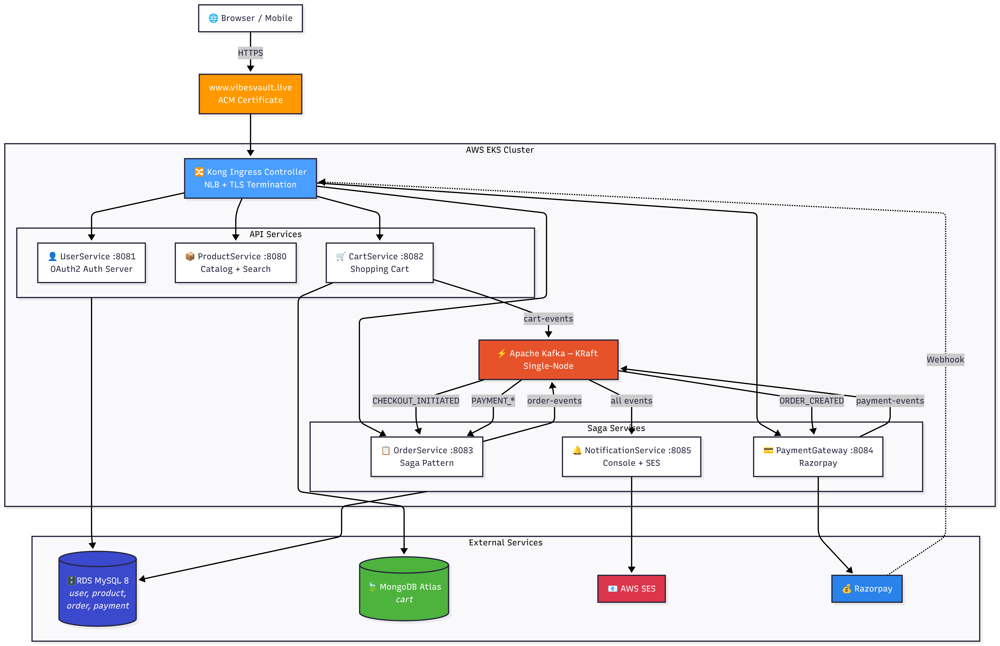
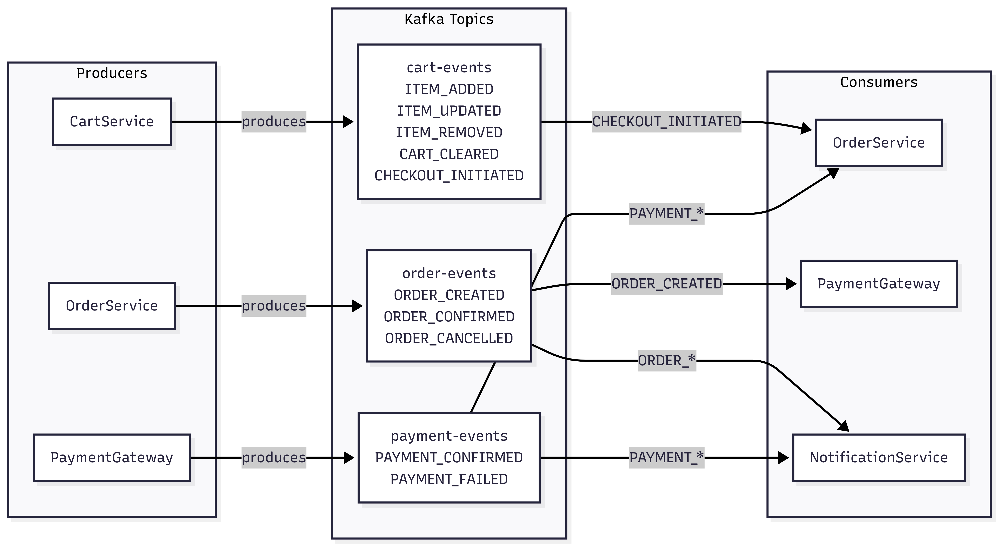
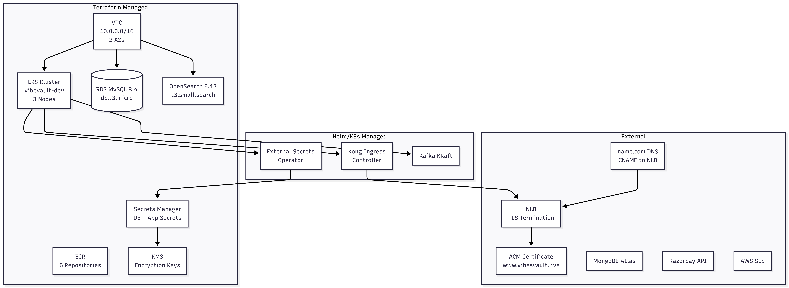
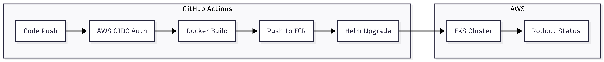

# VibeVault

A microservices e-commerce platform built with Spring Boot 4.0.3, Java 21, Apache Kafka, and deployed on AWS EKS using Terraform.

**Capstone Project** for Master of Science in Computer Science — Scaler Neovarsity (Woolf University).

---

## System Architecture



Six microservices communicate through Apache Kafka events. Client traffic enters via HTTPS through an AWS NLB with TLS termination, routed by Kong Ingress Controller to the appropriate service.

---

## Repositories

| Repository | Description | Tech Stack |
|---|---|---|
| [userservice](https://github.com/spa-raj/userservice) | OAuth2 Authorization Server, user registration, role-based access control | Spring Security, Spring Authorization Server, MySQL, Flyway |
| [productservice](https://github.com/spa-raj/productservice) | Product catalogue, category management, full-text search on 2M products | Spring Data JPA, OpenSearch 2.17, MySQL, Flyway |
| [cartservice](https://github.com/spa-raj/cartservice) | Shopping cart with multi-user isolation, checkout event publishing | MongoDB Atlas, Spring Data MongoDB, Kafka Producer |
| [orderservice](https://github.com/spa-raj/orderservice) | Order creation from cart events, saga state management, paginated history | MySQL, Kafka Consumer/Producer, Flyway |
| [paymentgateway](https://github.com/spa-raj/paymentgateway) | Razorpay payment link creation, webhook verification, payment state machine | Razorpay SDK, MySQL, Kafka Consumer/Producer, Flyway |
| [notificationservice](https://github.com/spa-raj/notificationservice) | Email notifications for order and payment events via Console + AWS SES | Kafka Consumer, AWS SES SDK v2, Strategy Pattern |
| [vibevault-infra](https://github.com/spa-raj/vibevault-infra) | Terraform IaC, Helm values, K8s manifests, GitHub Actions infra workflows | Terraform, Helm, Kong, External Secrets Operator |

---

## Saga Pattern — Checkout Flow

The platform uses a choreography-based Saga pattern for distributed transactions. No central orchestrator — each service reacts to Kafka events independently.


**Flow:** Cart checkout → `CHECKOUT_INITIATED` → Order created (PENDING) → `ORDER_CREATED` → Razorpay payment link → User pays → Webhook → `PAYMENT_CONFIRMED` → Order updated (CONFIRMED) → Email notifications at each stage via AWS SES.

---

## Kafka Event Flow

Three Kafka topics carry events between services:



| Topic | Producer | Consumers | Key Events |
|---|---|---|---|
| `cart-events` | CartService | OrderService | CHECKOUT_INITIATED |
| `order-events` | OrderService | PaymentGateway, NotificationService | ORDER_CREATED, ORDER_CONFIRMED, ORDER_CANCELLED |
| `payment-events` | PaymentGateway | OrderService, NotificationService | PAYMENT_CONFIRMED, PAYMENT_FAILED |

---

## Infrastructure

Deployed on AWS (ap-south-1) using Terraform with 6 modules. The EKS cluster runs 3 t3.medium nodes across 2 availability zones.



**AWS Services:** EKS, RDS MySQL 8.4, ECR, Secrets Manager, KMS, OpenSearch 2.17, SES, ACM, NLB

**Kubernetes:** Kong Ingress Controller, External Secrets Operator, Kafka (KRaft), Flyway init containers

**Domain:** [www.vibesvault.live](https://www.vibesvault.live) — DNS managed at name.com, TLS via ACM certificate

---

## CI/CD Pipeline

Each service has a GitHub Actions workflow: Docker build → ECR push → Helm deploy to EKS. AWS authentication uses OIDC (no static credentials).



---

## Tech Stack

| Layer | Technologies |
|---|---|
| **Backend** | Spring Boot 4.0.3, Java 21, Spring Security OAuth2, Spring Data JPA/MongoDB |
| **Messaging** | Apache Kafka (KRaft mode), JSON serialisation |
| **Databases** | MySQL 8.4 (RDS), MongoDB Atlas, OpenSearch 2.17 |
| **Infrastructure** | Terraform, Helm, Docker, Kubernetes (EKS) |
| **AWS** | EKS, RDS, ECR, Secrets Manager, KMS, SES, ACM, NLB, OpenSearch |
| **CI/CD** | GitHub Actions, OIDC auth, ECR, Helm |
| **API Gateway** | Kong Ingress Controller |
| **Payments** | Razorpay (test mode) — payment links + webhook verification |

---

## Key Highlights

- **50 E2E tests** passing on live EKS deployment covering full saga flow
- **Razorpay integration** with real payment links and HMAC-SHA256 webhook verification
- **OpenSearch benchmarks** — MySQL LIKE queries: 0% success at 15 VUs; OpenSearch: 99.3% success, 27ms median
- **Idempotent event processing** via database unique constraints on event IDs
- **Payment state machine** preventing illegal transitions with conflict-safe webhook handling
- **AWS SES email** notifications triggered automatically from Kafka events
- **Infrastructure as Code** — entire platform created/destroyed via `terraform apply`/`destroy`

---

## E2E Testing

A comprehensive end-to-end test script validates the full platform on EKS:

```bash
./scripts/test-eks-e2e.sh
```

Covers 55 tests including HTTPS via Kong, OAuth2 authentication, product CRUD, cart operations, checkout saga, order verification, Razorpay payment flow, multi-user isolation, error handling, and SES email delivery.
